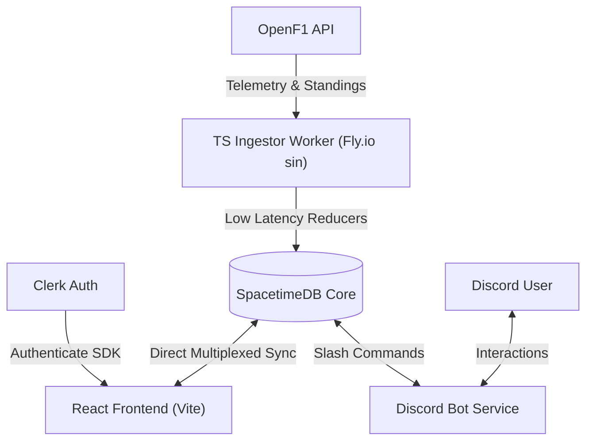
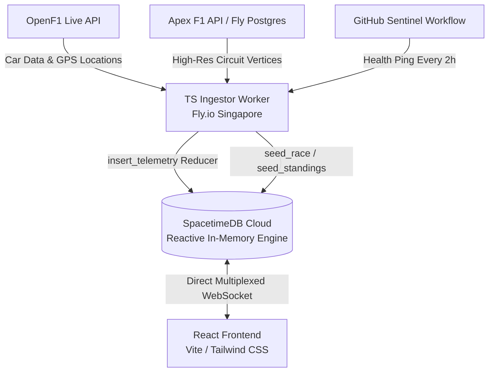

# SilverWall 🏎️

> [!NOTE]
> **ARCHITECTURE**: SilverWall runs on a **Full TypeScript + SpacetimeDB** architecture. The real-time telemetry engine, season races, circuit geometry, and championship standings are powered by **SpacetimeDB Cloud** with continuous live polling by our dedicated Fly.io ingestor worker in Singapore (`sin`).

### 🚀 Next-Gen Architecture (SpacetimeDB)


#### 🛠️ Production Milestones & Current State
- **SpacetimeDB Core Live**: 377+ historical & active F1 sessions, multi-season driver & constructor standings natively served via multiplexed WebSocket subscriptions.
- **Singapore GP Live Telemetry Ready**: Session 11388 (2026 Singapore Grand Prix at Marina Bay) registered as upcoming with 47 high-fidelity track vertices and real-time GPS coordinate normalization.
- **Autonomous Ingestor**: Dedicated Singapore-based Fly machine (`silverwall-ingestor`) continuously ingesting OpenF1 live telemetry, results, and adaptive standings bursts.
- **Circuit Geometry Alignment**: High-fidelity track normalization ensuring live car dots render directly on SVG outlines across all circuits.

**Engineering-Grade F1 Telemetry Dashboard**

SilverWall is powered by a **SpacetimeDB reactive engine**. It provides ultra-low latency F1 telemetry, session tracking, and historical data with zero frontend polling overhead.

---


---

## ⚡ Autonomous Features

### 🧠 Year-Agnostic Intelligence
The system dynamically activates the live race when `now >= date_start && now <= date_end`, seamlessly transitioning the entire UI from countdown mode to live telemetry pit-wall with zero manual intervention.

### 🏁 Automated Data Lifecycle
- **Dynamic Results**: The `/api/results` endpoint is 100% database-driven—no more hardcoded placeholders.
- **Standings Sync**: Automated pipelines fetch official positions and update championship standings.
- **Track Learning**: Autonomously captures and saves new circuit geometry during live sessions.

### 💓 Sentinel Monitoring & Interaction
SilverWall features a dual-layer Discord integration:

1. **Automation (Webhooks)**: 
   - `silverwall_automation.yml` triggers every 3 days.
   - Posts a rich, automated report to your designated channel.
   - Includes health status, leaderboard, and next race countdown.

2. **Interaction (Slash Commands)**:
   - **`/status`**: Check system health & next race.
   - **`/standings [year]`**: Get live or historical championship standings.
   - **`/results`**: Get detailed podium results of the last completed race.
   - **`/champions`**: See world champions of the latest completed season.
   - **`/next`**: Get countdown and location for the upcoming Grand Prix.

---

## 📁 Project Structure

```
silverwall/
├── 📂 ingestor/                    # Real-Time Telemetry Ingestor (Fly.io Node/TS)
│   ├── src/
│   │   ├── index.ts                # Main polling loop, session switcher, adaptive burst
│   │   └── sdk/                    # SpacetimeDB Client SDK (Reducers & Tables)
│   ├── fly.toml                    # Fly.io deployment config (Singapore sin region)
│   ├── Dockerfile                  # Container build (node:22-slim)
│   └── package.json                # undici, spacetimedb, axios, express
│
├── 📂 spacetimedb/                 # SpacetimeDB Module Definition
│   └── src/                        # In-memory reactive tables & reducers
│
├── 📂 Silverwall UIUX design system/  # React Frontend (Vite + TypeScript)
│   ├── index.html                  # HTML entry point
│   ├── vite.config.ts              # Vite configuration
│   ├── tailwind.config.js          # Tailwind CSS styling
│   └── src/
│       ├── App.tsx                 # App routes
│       ├── contexts/
│       │   └── SpacetimeContext.tsx # Global WebSocket provider to SpacetimeDB
│       ├── pages/
│       │   ├── Landing.tsx         # Race card, countdown & season overview
│       │   ├── TelemetryLive.tsx   # Live pit-wall telemetry & normalized track map
│       │   └── DesignSystem.tsx    # F1 HUD design tokens & components
│       ├── components/
│       │   ├── TrackMap.tsx        # High-res SVG circuit rendering
│       │   ├── CountdownOverlay.tsx # Live session countdown HUD
│       │   └── ResultsModal.tsx    # Interactive championship results
│       ├── hooks/
│       │   ├── useSpacetimeStatus.ts    # Live race status & real-time countdown
│       │   ├── useSpacetimeTelemetry.ts # Normalized car coordinates & telemetry stream
│       │   ├── useStandings.ts          # Reactive driver & constructor standings
│       │   └── useTrack.ts              # Vertex track geometry loader
│       └── sdk/                    # Generated SpacetimeDB TypeScript client
│
├── 📂 backend/                     # FastAPI Backend (Geometry & Apex Bridge)
│   ├── main.py                     # FastAPI entry point
│   ├── routes/
│   │   ├── track.py                # High-res circuit geometry normalization
│   │   ├── status.py               # Session status & health checks
│   │   └── discord.py              # Discord Bot slash command gateway
│   └── tracks.json                 # Static circuit geometry database
│
├── 📂 .github/workflows/
│   ├── ingestor-sentinel.yml       # Ingestor health keepalive & auto-healer
│   └── deploy-pages.yml            # CI build & automated verification
│
└── README.md                       # Documentation
```

---

## 🏗️ Architecture



---

## 🗄️ SpacetimeDB Reactive Schema

| Table | Primary Columns | Description |
|---|---|---|
| `race` | `race_key`, `name`, `meeting_name`, `date`, `circuit_key`, `status` | Full season schedules (upcoming, live, ended) |
| `telemetry` | `driver_number`, `session_key`, `speed`, `rpm`, `gear`, `x`, `y` | Live streaming telemetry frames per car |
| `track_point` | `circuit_key`, `order`, `x`, `y` | Ordered SVG vertex paths for track rendering |
| `driver` | `driver_number`, `name`, `team`, `color` | F1 grid driver profiles and team branding |
| `driver_standings` | `season_year`, `position`, `driver_name`, `points`, `wins` | World Drivers' Championship standings |
| `constructor_standings` | `season_year`, `position`, `team`, `points`, `wins` | World Constructors' Championship standings |
| `race_result` | `race_key`, `position`, `driver_name`, `points`, `fastest_lap` | Official classified race results and podiums |

---

## 🚀 Quick Start

### 1. Database Setup
SilverWall uses an idempotent **"Delete-then-Insert"** migration strategy. This means you can run these scripts multiple times to reset your data to a clean state without hitting unique constraint errors.

Run the migrations in the following order in your Supabase SQL Editor:
1.  **`001_create_tables.sql`**: Core schema (tables & constraints).
2.  **`002_historical_2024.sql`**: Full 2024 archive (Standings & Podium Results).
3.  **`003_historical_2025.sql`**: Full 2025 archive (Standings & Official Results).
4.  **`004_seed_2026_season.sql`**: 2026 Season Kickoff (Upcoming events).
5.  **`005_seed_tracks.sql`**: Bootstrap Track Maps (Geometry data).

### 2. Environment Variables
Create `backend/env/.env.supabase`:
```env
SUPABASE_URL=https://your-project.supabase.co
SUPABASE_SERVICE_KEY=your-service-role-key
DISCORD_WEBHOOK_URL=https://discord.com/api/webhooks/...
```

Create `Silverwall UIUX design system/.env`:
```env
VITE_API_URL=http://localhost:8000
```

### 3. Run Locally

**Backend:**
```bash
cd backend
pip install -r requirements.txt
python -m uvicorn main:app --reload --port 8000
```

**Frontend:**
```bash
cd "Silverwall UIUX design system"
npm install
npm run dev -- --port 3000
```

---

## 🔌 API Endpoints

| Endpoint | Method | Description |
|----------|--------|-------------|
| `/api/status` | GET | Race status, countdown, next event |
| `/api/champions` | GET | Current season champions |
| `/api/standings/drivers/{year}` | GET | Driver championship standings |
| `/api/standings/constructors/{year}` | GET | Constructor standings |
| `/api/season/races/{year}` | GET | Race schedule with podium results |
| `/api/track/{circuit}` | GET | Track SVG geometry |
| `/api/results` | GET | Latest race results |
| `/api/discord/interactions` | POST | Discord Bot slash command gateway |

---

## 🔐 GitHub Secrets

| Secret | Description |
|--------|-------------|
| `SUPABASE_URL` | Your Supabase Project API URL |
| `SUPABASE_SERVICE_KEY` | Service Role Key (write access) |
| `DISCORD_WEBHOOK_URL` | Discord health channel webhook |
| `DISCORD_APP_ID` | Discord Bot Application ID |
| `DISCORD_PUBLIC_KEY` | Discord Bot Public Key |
| `DISCORD_BOT_TOKEN` | Discord Bot Auth Token |

---

## 🚀 Deployment

| Platform | Config File |
|----------|-------------|
| **Vercel** | `backend/vercel.json` |
| **Railway** | `railway.json` |
| **Docker** | `Dockerfile` |

---

## 📅 Roadmap

- [x] Autonomous Season Transitions
- [x] Dynamic Track Map Learning
- [x] Automated Standings Ingestion
- [x] Off-Season Countdown Display
- [x] Two-Way Discord Interaction Engine
- [ ] AI-Powered Race Strategy Predictions
- [ ] Multi-Driver Multi-View Layout
- [ ] Lap Time Comparison Charts

---

## 🛠️ Tech Stack

| Layer | Technology |
|---|---|
| **Frontend** | React 18, TypeScript, Vite, Tailwind CSS, SpacetimeDB Web SDK |
| **Telemetry Ingestor** | Node.js 22, TypeScript, Undici WebSocket, Express Healthcheck |
| **Reactive Database** | SpacetimeDB Cloud (Multiplexed WebSockets & In-Memory Reducers) |
| **Backend & Geometry** | FastAPI, Python 3.11, Pydantic, Apex Circuit API |
| **Cloud Infrastructure** | Fly.io (Singapore `sin` region), Vercel |
| **External APIs** | OpenF1 Live API, Ergast / Jolpi F1 Archive |
| **CI/CD & Monitoring** | GitHub Actions Keepalive Sentinel, Discord Webhooks |

---

## 📄 License

MIT License | Built with passion for F1 Engineering.

---

<p align="center">
  <strong>🏎️ SilverWall</strong> — Where Data Meets the Track
</p>

*Last updated to maintain streak*
