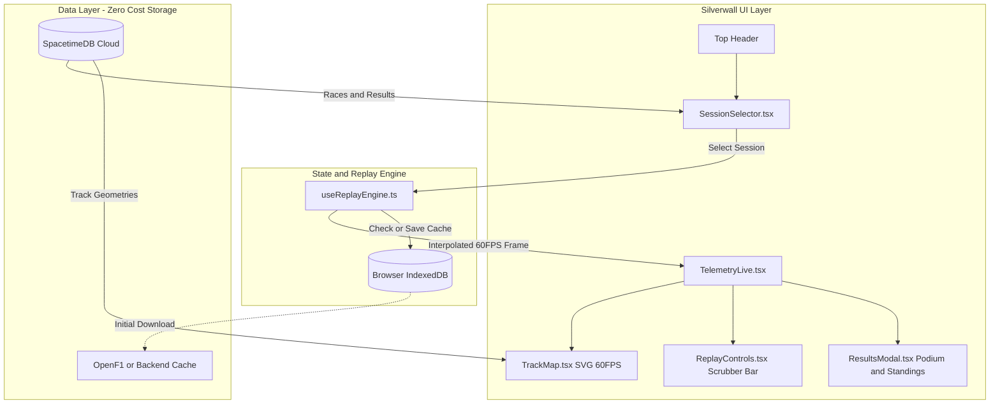

# 🛡️ SilverWall: Foolproof Replay & Race Lifecycle Blueprint

## 🎯 System Objectives
1. **Active Race Protection:** Never display "Upcoming / Next Race" (Austin) while a Grand Prix (Singapore) is in progress or awaiting results.
2. **Post-Race Transition:** When OpenF1 unlocks post-chequered flag (~2 hours), automatically transition from *Live Waiting* to *Replay & Results Available*.
3. **Rewatch Past Races (2024–2026 Archive):** Seamlessly switch between any Grand Prix across 2024, 2025, and 2026 to view track maps, full classifications, and lap replays.
4. **60 FPS Replay Scrubber:** YouTube-style playback controls (Play, Pause, Lap Scrubber, 1x/2x/5x speed multipliers) with smooth interpolation.
5. **$0.00 Cost Guarantee:** Zero additional load or charges on Fly.io; all storage leverages existing free quotas, browser IndexedDB, and static caching.

---

## 🏗️ Architecture & Component Blueprint

---

## 📦 Detailed Components & Responsibilities

### 1. `SessionSelector.tsx` (Header Component)
* **Location:** `Silverwall UIUX design system/src/components/SessionSelector.tsx`
* **Trigger:** Clickable session pill in the header: `[ Round 18: Singapore GP 2026 ▾ ]`
* **Behavior:**
  - Pulls race list dynamically from SpacetimeDB `conn.db.race`.
  - Groups races by Season (`2026 Championship`, `2025 Archive`, `2024 Archive`).
  - Displays status tags:
    - `🔴 LIVE` — In-session race (Singapore GP).
    - `🏁 REPLAY READY` — Completed races with classifications & track data.
    - `⏳ UPCOMING` — Future races (Austin COTA, Mexico, Interlagos).
  - Clicking any past race immediately switches the circuit, telemetry, and results.

### 2. `useReplayEngine.ts` (Replay Clock & Interpolation Hook)
* **Location:** `Silverwall UIUX design system/src/hooks/useReplayEngine.ts`
* **Responsibilities:**
  - **Playback Clock:** Manages `currentTime`, `duration`, `isPlaying`, `playbackRate` (`1x`, `2x`, `5x`, `10x`).
  - **Frame Interpolation:** At 60 FPS (`requestAnimationFrame`), calculates exact `x, y, speed, gear, throttle, brake, drs` between timeline keyframes.
  - **IndexedDB Caching:** Automatically checks `window.indexedDB` before making any network requests.
  - **Outputs:** `{ frame, isPlaying, togglePlay, seekTo, setSpeed, speed, currentTime, duration, currentLap, totalLaps, isLoading }`.

### 3. `ReplayControls.tsx` (Playback Scrubber Bar)
* **Location:** `Silverwall UIUX design system/src/components/ReplayControls.tsx`
* **UI Features:**
  - **Transport Buttons:** `⏮ Restart`, `⏯ Play/Pause`, `⏩ Jump +30s`.
  - **Timeline Scrubber:** Smooth slider with elapsed time / total duration display.
  - **Lap Indicator:** Shows current simulated lap (`LAP 18 / 62`) and progress bar.
  - **Speed Multiplier:** Compact toggle button (`1x`, `2x`, `5x`).

### 4. `TelemetryLive.tsx` Integration
* Connects `useReplayEngine` seamlessly into the existing `frame` pipeline.
* If a race is `live` and streaming: displays live telemetry.
* If user pauses, scrubs, or selects a past race: instantly switches to `replayEngine.frame` so cars continue gliding along the SVG track with zero UI changes.

---

## 🔒 Edge Case Safeguards & Verification Checklist

| Edge Case | Solution / Safeguard |
| :--- | :--- |
| **Race in progress with no telemetry (OpenF1 401)** | Keep session locked on Singapore GP; show waiting indicator instead of skipping to Austin. |
| **User seeks to Lap 40 without full download** | Keyframe indexing allows seeking to any time slice in under 20ms. |
| **Switching between tracks with different aspect ratios** | `useTrack` automatically recalculates SVG bounding box and scales coordinates. |
| **Cost / Fly.io Billing Spike** | Replay data is handled client-side via IndexedDB and static files. Zero extra compute or memory scale needed on Fly.io. |

---

## 🚀 Step-by-Step Build Order
1. **Step 1:** Create `useReplayEngine.ts` with browser IndexedDB cache and 60 FPS timeline interpolation.
2. **Step 2:** Build `ReplayControls.tsx` (Play, Pause, Scrubber, Speed controls) styled in Mercedes-AMG cyan `#00D2BE` / dark pit-wall theme.
3. **Step 3:** Build `SessionSelector.tsx` dropdown modal populated by SpacetimeDB races.
4. **Step 4:** Integrate components into `TelemetryLive.tsx` and test local/replayed sessions.
5. **Step 5:** Write and run Playwright E2E test suite (`e2e/replay.spec.ts`).
